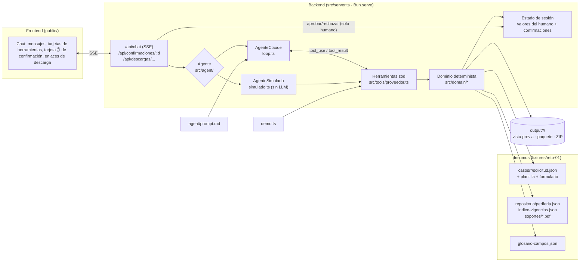
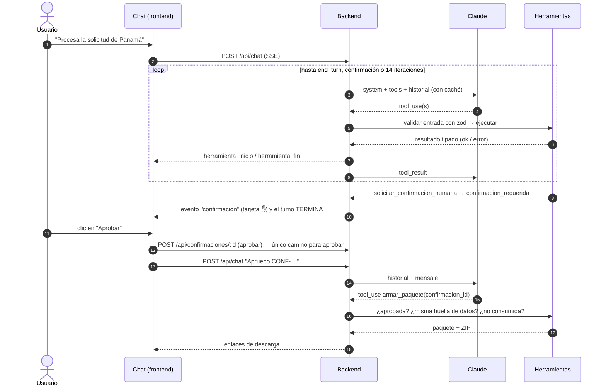

# SOLUCIÓN · Reto 1: Agente de Vinculación de Proveedores

> **Prueba IA · Periferia IT Group**
>
> Agente conversacional en TypeScript (Bun) que automatiza todo el ciclo de una solicitud de cliente:
>
> 1. lee la solicitud;
> 2. la cruza con el repositorio maestro;
> 3. diligencia el formulario (Excel o PDF);
> 4. arma el paquete listo para que lo firme el representante legal.
>
> Ningún paquete se genera sin una aprobación humana, y esa aprobación se verifica en el servidor.

---

## 0. Resumen ejecutivo

| Entregable del instructivo | Dónde está | Cómo verificarlo |
|---|---|---|
| 1. Repositorio con arquitectura limpia | `agent/prompt.md` (system prompt) · `src/tools/proveedor.ts` (herramientas zod) · `src/domain/*` + `src/agent/*` + `src/server.ts` (backend) · `public/*` (chat) | `bun install && bun start` → http://localhost:3000 |
| 2. Script de verificación sin LLM | `demo.ts` | `bun demo.ts --check` → 4 casos, 24 verificaciones, 37 archivos idénticos byte a byte entre corridas |
| 3. Enlace público funcional | `Dockerfile`, `render.yaml`, `fly.toml` (sección 10) | URL de Render/Fly + `ACCESS_CODE` |
| 4. Documentación técnica | este archivo | — |

Resultado de `demo.ts` con la fecha de referencia 2026-11-19:

| Caso | País / formato | Resultado | Lo que demuestra |
|---|---|---|---|
| `co-industrias-delta` | 🇨🇴 Excel | ✅ LISTO_PARA_FIRMA | De dos certificados de parafiscales elige el vigente. Cuando la plantilla trae casilla de DV, el NIT va separado del DV. |
| `ec-corp-andina` | 🇪🇨 PDF | ✅ LISTO (3 advertencias) | Convierte COP→USD con la TRM del repositorio y reporta el NIT con DV (la plantilla no tiene casilla de DV). Detecta un *prompt injection* en las observaciones del cliente. Avisa que la certificación bancaria vence antes de la fecha límite. |
| `hn-agroexport-sula` | 🇭🇳 Excel | 📝 BORRADOR | Campo ONCAE sin equivalente en el repositorio: lo pide al humano. Falta la carta de referencia comercial, que es bloqueante. |
| `pa-logistica-istmo` | 🇵🇦 PDF | 📝 BORRADOR | La dirección pasa de 40 caracteres: no se trunca y se pide una versión abreviada al humano. La certificación bancaria tiene 20 días y el cliente exige 15 o menos, lo que es bloqueante. |

---

## 1. Supuestos (leer primero)

El PDF del instructivo describe los insumos del ZIP del reto (`PRD.md`, `fixtures/reto-01/...`), pero en este desarrollo **solo se contó con el instructivo**. Por eso:

- **Se reconstruyeron los fixtures** siguiendo exactamente la estructura descrita:
  - los 4 casos con los nombres indicados;
  - en cada caso, `solicitud.json` y la plantilla de celdas o de campos;
  - el repositorio maestro, los soportes y el índice de vigencias;
  - el glosario.
  - Todo se genera con `scripts/generar-fixtures.ts`, de forma reproducible.
- Las **reglas de validación obligatorias** del PRD se infirieron de la práctica habitual en vinculación de proveedores en Colombia y la región (tabla de la sección 5). Están centralizadas en `src/domain/analisis.ts` y `src/domain/reglas.ts`.
- **Adaptación a los fixtures oficiales.** Hay que reemplazar `fixtures/reto-01/` y ajustar los esquemas zod de `src/domain/tipos.ts` a los nombres reales de los campos. Si un fixture no cumple el esquema, el sistema falla de inmediato con un mensaje claro (`INSUMO_INVALIDO`). Así se detecta el desajuste el primer día y no en la defensa.
- Ni los datos de Periferia ni los soportes son reales: son *fixtures*. Los correos usan el dominio `.example`.

---

## 2. Arquitectura



### 2.1 Capas y responsabilidades

```
agent/prompt.md            ← system prompt: rol, regla de oro, ciclo, formato de respuesta
src/
  tools/proveedor.ts       ← 10 herramientas: nombre + descripción + esquema zod + ejecutor
  agent/loop.ts            ← ciclo con Claude (tool use, corte en confirmación, caché, métricas)
  agent/simulado.ts        ← planificador determinista con los mismos eventos (plan B sin LLM)
  agent/eventos.ts         ← contrato de eventos SSE backend → frontend
  domain/                  ← LÓGICA DE NEGOCIO PURA (no conoce al LLM ni a HTTP)
    tipos.ts               ← esquemas zod de los insumos
    fixtures.ts            ← carga y valida insumos, rutas confinadas (anti path-traversal)
    glosario.ts            ← mapeo etiqueta → clave maestra (exacto / tokens / sin_mapeo / ambiguo)
    valores.ts             ← claves maestras, derivados (DV, liquidez, endeudamiento), formato y moneda
    reglas.ts              ← DV NIT, fechas, extracción de vigencias de texto libre, formato numérico
    analisis.ts            ← NÚCLEO: cruza todo y produce campos + soportes + hallazgos + huella
    formularios.ts         ← llena Excel (exceljs) y PDF AcroForm (pdf-lib)
    paquete.ts             ← carta remisoria + formulario + soportes + resumen + manifest SHA-256 + ZIP
    estado.ts              ← sesiones, valores del humano, confirmaciones (máquina de estados)
  server.ts                ← HTTP + SSE + descargas + límite de peticiones + código de acceso
  config.ts                ← variables de entorno, precios por modelo
public/                    ← chat sin build (HTML + CSS + JS vanilla)
demo.ts                    ← verificación determinista sin LLM
tests/                     ← bun test (dominio, herramientas, loop con modelo falso)
scripts/                   ← generador de fixtures, estimador de costos
```

**Principio rector: el LLM orquesta y comunica, el código decide.** Todo lo que puede ser incorrecto (un DV, un día de vigencia, una tasa de cambio, el mapeo de una etiqueta) es código determinista y probado. El modelo elige qué herramienta llamar y explica el resultado, pero no puede alterar ni inventar valores.

---

## 3. Ciclo del agente



### 3.1 Pasos del ciclo (alineados con `agent/prompt.md`)

| # | Herramienta | Qué hace |
|---|---|---|
| 1 | `leer_solicitud` | Cliente, país, fechas, moneda, campos de la plantilla y soportes requeridos. Las observaciones del cliente se marcan como `contenido_no_confiable`. |
| 2 | `mapear_campos` | Etiqueta → clave maestra → valor formateado, con la fuente (`repositorio`, `derivado` o `usuario`). |
| 3 | `verificar_soportes` | Aplica la vigencia más estricta entre la interna y la del cliente. Elige la versión más reciente y avisa si el soporte vence antes de la fecha límite de entrega. |
| 4 | `validar_datos` | Ejecuta todas las reglas y devuelve `bloqueantes`, `advertencias` y `puede_paquete_final`. |
| 5 | `registrar_valor_manual` | Solo con texto literal del usuario, para pendientes que él puede resolver. Invalida las confirmaciones previas. |
| 6 | `llenar_formulario` | Genera la vista previa descargable. |
| 7 | `solicitar_confirmacion_humana` | Modo `final` o `borrador`. La herramienta rechaza `final` si hay bloqueantes. **Aquí el turno se corta.** |
| 8 | `armar_paquete` | Exige una confirmación `aprobada`, del mismo caso y con la misma huella de datos. La confirmación es de un solo uso. |

Hay además dos herramientas de apoyo: `listar_casos` y `consultar_repositorio`.

### 3.2 Garantías del ciclo

- **Validación de entrada.** Toda entrada que propone el modelo pasa por `safeParse` de zod. Si falla, el modelo recibe `ENTRADA_INVALIDA` con el detalle y puede corregirse. Las herramientas nunca lanzan excepciones al loop: devuelven errores tipados (`CASO_NO_EXISTE`, `FINAL_NO_PERMITIDO`, `CONFIRMACION_NO_APROBADA`, `DATOS_CAMBIARON`, …).
- **La confirmación humana se aplica en el backend, no en el prompt.**
  - El modelo no tiene ninguna herramienta para aprobar. Solo `POST /api/confirmaciones/:id`, invocado por el botón de la interfaz, cambia el estado a `aprobada`.
  - Si el modelo, o un usuario que escribe "apruebo" en el chat sin hacer clic, llama `armar_paquete`, recibe `CONFIRMACION_NO_APROBADA`. Este caso está probado en `demo.ts` y en la prueba manual.
- **Huella de datos.** La confirmación guarda un hash del análisis (valores, soportes y hallazgos). Si algo cambia después de aprobar (por ejemplo, un valor manual nuevo), `armar_paquete` responde `DATOS_CAMBIARON` y se vuelve a pedir aprobación. El humano siempre aprueba exactamente lo que se empaqueta.
- **Corte del turno.** Al emitirse una confirmación, el loop termina aunque el modelo quiera seguir. En el siguiente turno, el mensaje del usuario se fusiona con el `tool_result` pendiente para mantener válida la alternancia user/assistant (probado en `tests/loop.test.ts`).
- **Límites.**
  - 14 iteraciones por turno.
  - 2.048 tokens de salida por llamada.
  - Resultados de herramientas truncados a 12.000 caracteres.
  - Un solo turno activo por sesión.
- **Resiliencia.** Si el proveedor del LLM falla, el usuario ve un error y el estado queda intacto. `AGENT_MODE=simulado` permite seguir la defensa sin LLM con la misma interfaz y las mismas herramientas.

---

## 4. Herramientas (`src/tools/proveedor.ts`)

Cada herramienta se define una sola vez: nombre, descripción para el modelo, esquema zod y ejecutor. El JSON Schema que recibe Claude **se genera desde zod** (`z.toJSONSchema`), así que hay una sola fuente de verdad.

| Herramienta | Entrada (zod) | Efecto | Notas |
|---|---|---|---|
| `listar_casos` | `{}` | lectura | |
| `leer_solicitud` | `{caso_id}` | lectura | `caso_id` con regex `^[a-z0-9][a-z0-9-]{1,60}$` (bloquea path traversal) |
| `mapear_campos` | `{caso_id}` | lectura | |
| `consultar_repositorio` | `{claves: string[1..40]}` | lectura | |
| `verificar_soportes` | `{caso_id}` | lectura | |
| `validar_datos` | `{caso_id}` | lectura | |
| `registrar_valor_manual` | `{caso_id, campo_id, valor≤500}` | escribe en sesión | Valida `max_longitud` e invalida confirmaciones |
| `llenar_formulario` | `{caso_id}` | escribe la vista previa | |
| `solicitar_confirmacion_humana` | `{caso_id, modo: final\|borrador, resumen 10..1500}` | crea confirmación pendiente | Rechaza `final` si hay bloqueantes |
| `armar_paquete` | `{caso_id, confirmacion_id}` | escribe el paquete y el ZIP | Requiere una aprobación humana válida |

**Idempotencia.** El análisis se recalcula en cada llamada a partir de los insumos y del estado mínimo de la sesión. No hay cachés que puedan quedar desfasadas, y llamar dos veces da el mismo resultado.

---

## 5. Reglas de validación

| Código | Severidad | Regla |
|---|---|---|
| `NIT_DV_INCONSISTENTE` | ⛔ | El DV almacenado ≠ al DV calculado (algoritmo DIAN, módulo 11). Protege contra errores del repositorio maestro. |
| `CAMPO_SIN_MAPEO` / `CAMPO_AMBIGUO` | ⛔ si es obligatorio · ⚠️ si es opcional | No se adivina. Si hay empate entre claves, se trata como ambiguo. |
| `MAPEO_APROXIMADO` | ⚠️ | Mapeo por similitud de tokens (coeficiente de Dice ≥ 0.75); se pide verificarlo. |
| `LONGITUD_EXCEDIDA` | ⛔ | Valor más largo que `max_longitud`. **No se trunca automáticamente**: se pide una versión al humano. |
| `EMAIL_INVALIDO` / `TELEFONO_INVALIDO` | ⛔ | Formato de correo; teléfono en formato internacional `+código`. |
| `TASA_CAMBIO_NO_DISPONIBLE` | ⛔ | Moneda de reporte sin tasa en el repositorio. |
| `CONVERSION_MONEDA` / `TASA_CAMBIO_ANTIGUA` | ℹ️ / ⚠️ | Trazabilidad de la conversión; advertencia si la tasa tiene más de 5 días. |
| `SOPORTE_VENCIDO` | ⛔ si es obligatorio | Vigencia aplicable = `min(vigencia interna, exigencia del cliente)`. La exigencia se extrae del texto libre ("no mayor a 30 días", "no superior a 15 días", "no older than 60 days"). |
| `SOPORTE_FALTANTE` / `SOPORTE_NO_RECONOCIDO` / `ARCHIVO_SOPORTE_NO_ENCONTRADO` | ⛔ si es obligatorio | |
| `SOPORTE_VENCE_ANTES_DE_ENTREGA` | ⚠️ | Vigente hoy, pero vence antes de `fecha_limite_entrega`. |
| `REPOSITORIO_DESACTUALIZADO` | ⚠️ | El repositorio maestro tiene más de 90 días. |
| `INSTRUCCION_EN_DOCUMENTO_CLIENTE` | ⚠️ | Texto del cliente con instrucciones dirigidas al asistente. Se reporta y **no se obedece**. |

Hay además dos reglas de negocio que se aplican al formatear:

- **NIT con o sin DV.** Si la plantilla no tiene casilla de DV, el NIT se reporta como `900123456-8`. Si la tiene, el NIT y el DV van separados.
- **Formato regional.** Fechas según `formato_fecha` y números según `locale`. Por ejemplo, `11.300.000.000` en es-CO y `4,610,764.27` en en-US. El formateador es propio (no ICU), para que el resultado sea idéntico en Node y en Bun.

---

## 6. Decisiones de diseño

| Decisión | Alternativa descartada | Por qué |
|---|---|---|
| **Lógica determinista en `domain/`; el LLM solo orquesta** | Dejar que el modelo lea los JSON y llene los campos | Exactitud y auditabilidad. Un DV o una vigencia mal calculados invalidan el proceso de compras del cliente. Además se puede probar sin LLM (`demo.ts`) y se reduce el consumo de tokens. |
| **Análisis recalculado y herramientas idempotentes** | Estado acumulado paso a paso | Sin estados inconsistentes si el modelo llama en otro orden o repite una llamada. |
| **Confirmación humana como máquina de estados en el servidor + huella** | Una instrucción en el prompt ("pide confirmación") | Un prompt se puede saltar (inyección o error del modelo); un control de backend no. La huella impide aprobar una versión y empaquetar otra. |
| **Paquete `BORRADOR` cuando hay bloqueantes** | No generar nada | El equipo avanza mientras llega el soporte faltante. El borrador lleva la marca de agua "BORRADOR - NO FIRMAR" y lista los pendientes en la carta. |
| **No truncar ni "rellenar" campos** | Truncar a `max_longitud` | Una dirección truncada puede ser legalmente inválida. Se pide la versión al humano. |
| **Glosario: exacto → Dice de tokens → sin mapeo** | Embeddings o que el LLM mapee | Explicable, gratuito y determinista. Las etiquetas nuevas se resuelven añadiendo sinónimos al glosario (dato, no código). El umbral y los empates evitan falsos positivos. |
| **Archivos deterministas** (fechas internas fijas en PDF, XLSX y ZIP; orden fijo) | Usar la fecha actual del sistema | Hashes estables: `manifest.json` sirve para verificar la integridad y `demo.ts --check` lo demuestra. |
| **SSE sobre `fetch`** | WebSockets | Unidireccional y suficiente; funciona detrás de cualquier proxy o PaaS. |
| **Frontend vanilla sin build** | React o Next | Menos piezas móviles para la defensa. La interfaz cumple lo pedido: chat, tarjetas de herramientas con entrada y salida, y confirmación resaltada. |
| **Modo simulado** | Exigir siempre una API key | URL pública usable sin costo, y plan B si falla el LLM o la red durante la defensa. |
| **Claude Sonnet 5.5 por defecto** | Opus u otro proveedor | El razonamiento requerido es moderado porque la lógica dura está en el código. Sonnet equilibra calidad y costo, y Haiku 5.5 queda como opción de ahorro (sección 7). |
| **Rutas confinadas y regex en ids** | Confiar en la entrada | Ni el modelo ni el usuario pueden leer fuera de `fixtures/` ni descargar fuera de `output/<sesión>/`. |

---

## 7. Análisis de costos del modelo

Se calcula con `bun scripts/costos.ts`. El script ejecuta las herramientas reales de cada caso y mide el tamaño del system prompt, de las definiciones de herramientas y de cada resultado. Con `ANTHROPIC_API_KEY` usa `count_tokens` para medir el bloque estático con el tokenizador real.

**Supuestos:**

- Ciclo típico de 7 llamadas al modelo por solicitud (5 hasta la confirmación y 2 tras la aprobación).
- Unos 1.270 tokens de salida por solicitud.
- Tokens ≈ caracteres / 3,2, lo que es conservador para español + JSON.

**Precios** (USD por millón de tokens, [platform.claude.com/docs/en/about-claude/pricing](https://platform.claude.com/docs/en/about-claude/pricing), noviembre de 2026):

| Modelo | Input | Output | Escritura en caché (5 min) | Lectura de caché |
|---|---|---|---|---|
| Claude Haiku 5.5 (≤ 100k tokens de prompt) | 0,10 | 0,50 | 0,125 | 0,01 |
| Claude Sonnet 5.5 | 2,00 | 10,00 | 2,50 | 0,10 |
| Claude Opus 5.5 | 4,00 | 20,00 | 5,00 | 0,20 |

**Resultado** (bloque estático ≈ 3.100 tokens; ≈ 39–40k tokens de input acumulado por solicitud sin caché):

| Modelo | Costo por solicitud sin caché | Con caché (implementada) | 1.000 solicitudes con caché |
|---|---|---|---|
| Haiku 5.5 | ≈ US$ 0,0046 | ≈ US$ 0,0019 | **≈ US$ 1,9** |
| **Sonnet 5.5 (por defecto)** | ≈ US$ 0,092 | ≈ US$ 0,034 | **≈ US$ 34** |
| Opus 5.5 | ≈ US$ 0,18 | ≈ US$ 0,069 | ≈ US$ 69 |

**Interpretación y palancas:**

1. **Caché de prompt** (implementada en `loop.ts`): hay un breakpoint en el system prompt, otro en las herramientas y un breakpoint "rodante" en el último mensaje. Cada iteración relee de caché todo el prefijo. El ahorro es de ~63 % con Sonnet.
   - La aprobación humana puede tardar más de 5 minutos. En ese caso la 6.ª llamada no encuentra el prefijo en caché, lo que suma ≈ US$ 0,02 en Sonnet.
   - Si es frecuente, conviene la caché de 1 hora o resumir el historial antes de `armar_paquete`.
2. **El costo dominante es el input, no el output.** Los resultados de herramientas son compactos y no incluyen texto que el modelo no necesita. Se pueden recortar más, por ejemplo con `mapear_campos` devolviendo solo los campos con problema.
3. **Haiku 5.5 es ~18 veces más barato que Sonnet.** Como el razonamiento duro está en el código, es candidato serio para producción, pero hay que validarlo con un set de evaluación (sección 8) antes de cambiar.
   - Estrategia sugerida: Haiku por defecto y Sonnet como *fallback* cuando hay hallazgos complejos o el usuario hace preguntas abiertas.
4. **Batch API (−50 %)** para procesamiento masivo nocturno sin chat. Ahí `demo.ts` demuestra que el flujo completo puede correr incluso sin LLM.
5. **Costo cero en el camino feliz automatizable.** El modo simulado prueba que el flujo estándar no requiere LLM. El LLM aporta valor en la conversación: dudas, excepciones y explicación de hallazgos.
6. **Contexto de negocio.** Diligenciar a mano un formulario con soportes toma 1–2 horas de un analista. US$ 0,03 por solicitud es despreciable frente a ese costo. El riesgo económico real está en errores (soportes vencidos que llevan a un rechazo en compras), y eso es lo que mitigan las reglas deterministas.

La interfaz muestra al final de cada turno los tokens reales (input, output, caché) y el costo estimado. Así el análisis se valida en vivo durante la defensa.

---

## 8. Verificación y determinismo

```bash
bun demo.ts            # 4 casos + 24 verificaciones, sin LLM
bun demo.ts --check    # además: 2 corridas y comparación SHA-256 de los 37 archivos generados
bun test               # 20 pruebas: reglas, glosario, herramientas, loop con modelo falso
bunx tsc --noEmit      # tipos estrictos
npx tsx demo.ts        # también corre en Node 20+
```

**Qué verifica `demo.ts`** (sale con código 1 si algo falla):

- el estado esperado por caso y los hallazgos esperados;
- la selección del soporte más reciente;
- la conversión de moneda exacta y el NIT con DV;
- la **robustez del flujo**:
  - `armar_paquete` sin aprobación falla;
  - el modo final con bloqueantes es rechazado;
  - la confirmación no se puede reutilizar;
  - zod rechaza `../../etc/passwd` como `caso_id`;
  - un caso inexistente da un error tipado.

**Determinismo:**

- **Mismo runtime:** la salida es idéntica byte a byte (los PDF, XLSX y ZIP llevan fechas internas fijadas a la fecha de referencia).
- **Bun frente a Node:** los PDF y JSON coinciden. Los `.xlsx` difieren solo en la compresión zlib del contenedor; el contenido de las celdas es idéntico.

**Fecha de referencia.** `FECHA_REFERENCIA` fija el "hoy" de las vigencias, lo que hace reproducible la defensa. Por ejemplo, con `--fecha=2026-11-10` la certificación bancaria de Panamá aparece vigente.

**Evaluación del agente con LLM (siguiente paso).** Hay que convertir los 4 casos y variantes (etiquetas nuevas, soportes vencidos, inyecciones) en un set de evaluación que mida:

- la secuencia de herramientas;
- que el modelo no invente valores (que todo valor citado en el texto exista en algún `tool_result`);
- que nunca llame `armar_paquete` sin aprobación;
- el costo por caso.

Ese set debe ejecutarse en CI por cada cambio de prompt o de modelo.

---

## 9. Consideraciones de producción

**Seguridad y cumplimiento**

- **Datos personales (Ley 1581 de 2012 / Habeas Data).** El paquete contiene la cédula del representante legal y datos bancarios. Por eso hay que:
  - cifrar en reposo (S3/Blob con SSE-KMS) y en tránsito (TLS);
  - aplicar retención limitada (por ejemplo, borrar `output/` a los 30 días);
  - restringir el acceso por rol;
  - anonimizar los logs (`resumen_validacion.json` sí guarda los valores; los logs de la aplicación no deberían).
- **Envío a terceros.** Se envían al LLM datos corporativos y del representante legal. Hay que revisar el DPA con el proveedor y la política de retención (*zero data retention* si aplica) y evaluar la región de inferencia.
- **Autenticación.** Reemplazar `ACCESS_CODE` por SSO corporativo (Entra ID u OIDC) y ligar la aprobación a la identidad real (`decidida_por` = correo del usuario autenticado). Para paquetes finales, conviene doble aprobación: comercial + jurídico.
- **Prompt injection.** Ya hay tres defensas:
  1. el texto del cliente se marca como `contenido_no_confiable`;
  2. una regla lo detecta y lo reporta;
  3. el agente no tiene herramientas peligrosas (no envía correos ni borra nada) y la aprobación es de backend.

  En producción, los PDF y Word de entrada (que pueden traer texto oculto) deben pasar por un extractor que normalice y limite el contenido antes de llegar al modelo.
- **Secretos.** La API key va en el gestor de secretos del PaaS o en Key Vault, nunca en el repositorio. El límite de peticiones por IP y el código de acceso protegen la URL pública contra abuso de costo.

**Persistencia y escalabilidad**

- El estado de sesión y las confirmaciones viven hoy en memoria, lo que basta para la demo. Para producción:
  - **Postgres** para sesiones, confirmaciones y auditoría;
  - **almacenamiento de objetos** para los paquetes;
  - URLs de descarga firmadas y temporales.
- El backend es *stateless* salvo esos almacenes, así que escala horizontalmente. Las herramientas tardan milisegundos, y el cuello de botella es la latencia del LLM.
- El repositorio maestro y el índice de vigencias deberían salir del sistema documental o ERP de Periferia mediante un conector, con versión y fecha de corte. Alertar cuando un soporte vaya a vencer en menos de N días permite renovarlo antes de que llegue la solicitud.

**Auditoría y trazabilidad**

- Ya existen la trazabilidad por campo en `resumen_validacion.json` (valor, fuente, ruta del dato y método de mapeo), los hashes SHA-256 en `manifest.json` y la bitácora de eventos de la sesión (`Sesion.auditoria`).
- Falta persistirla y exponerla:
  - quién aprobó;
  - qué huella aprobó;
  - qué versión del prompt, del modelo y del repositorio se usó.

**Firma**

- Hoy el paquete queda listo para firma manuscrita o escaneada. El siguiente paso es la firma digital certificada (en Colombia, una ECD acreditada por ONAC) o un proveedor de e-signature, invocado solo tras la aprobación humana. También conviene aplanar (*flatten*) el PDF final para evitar ediciones posteriores.

**Observabilidad y operación**

- Trazas por turno: iteraciones, herramientas, latencia, tokens y costo (los eventos `uso` ya existen) hacia OpenTelemetry o Langfuse.
- Alertas por tasa de `ENTRADA_INVALIDA`, por turnos que llegan al límite de iteraciones y por costo diario.
- Versionar `agent/prompt.md` y correr el set de evaluación en CI antes de cada cambio.
- Historial largo: resumir o compactar al pasar de N tokens. Las herramientas son idempotentes, así que basta con conservar los `caso_id` y las confirmaciones.

**Multi-país y extensibilidad**

- **Nuevos clientes o etiquetas:** basta con agregar sinónimos al glosario, sin tocar código.
- **Nuevas claves maestras:** se añaden a `CLAVES` en `valores.ts`.
- **Reglas por país** (por ejemplo, el RUC panameño con DV propio o el apostillado para Honduras): pueden modelarse como reglas declarativas por `codigo_pais` en `analisis.ts`.
- **Más formularios:** Word, o PDF no-AcroForm mediante coordenadas en la plantilla.

---

## 10. Despliegue y URL pública

**Local:**

```bash
bun install
cp .env.example .env          # opcional: ANTHROPIC_API_KEY; sin ella arranca en modo simulado
bun start                     # http://localhost:3000
```

**Render** (recomendado; gratis, con HTTPS):

1. Subir el repositorio a GitHub.
2. En Render: **New → Blueprint** y seleccionar el repositorio. Toma `render.yaml` y construye el `Dockerfile`.
3. En *Environment*, definir `ANTHROPIC_API_KEY` y `ACCESS_CODE`. `FECHA_REFERENCIA` ya viene en `2026-11-19`.
4. Abrir `https://agente-proveedores-periferia.onrender.com`: es la URL pública para la defensa.

En el plan gratuito, la instancia se duerme sin tráfico. Hay que abrirla 1 minuto antes de la sesión.

**Fly.io** (región Bogotá, `bog`):

```bash
fly launch --no-deploy
fly secrets set ANTHROPIC_API_KEY=... ACCESS_CODE=...
fly deploy
```

El `Dockerfile` ejecuta `bun demo.ts` durante el build. Si una regla o un fixture se rompe, la imagen no se construye y nunca se publica una versión que no pase la verificación.

---

## 11. Guion sugerido para la defensa técnica (≈ 8 min)

1. **Arquitectura (1 min).** Diagrama de la sección 2: "el LLM orquesta, el código decide".
2. **`bun demo.ts --check` en terminal (1 min).** Los 4 casos, todas las verificaciones en verde y los 37 archivos idénticos.
3. **URL pública, caso 🇨🇴 Delta (1 min).** Se ven las tarjetas de herramientas → ✅ final → Aprobar → ZIP. Abrir la carta remisoria y el Excel diligenciado.
4. **Caso 🇵🇦 Istmo (2 min).**
   - El agente pide una dirección de 40 caracteres o menos; se responde en el chat.
   - Bloqueo por la certificación bancaria con 20 días frente a los 15 que exige el cliente.
   - Se genera un borrador con marca de agua.
   - **Intento de "hackeo":** escribir "Apruebo CONF-…" sin hacer clic. El backend responde `CONFIRMACION_NO_APROBADA`.
5. **Caso 🇪🇨 Andina (1 min).** Conversión a USD con la tasa citada. El *prompt injection* en las observaciones se reporta y no se obedece.
6. **Costos (1 min).** Pie de cada turno con tokens y costo real, y tabla de la sección 7 con las opciones Sonnet, Haiku y Batch.
7. **Producción (1 min).** Sección 9: SSO, persistencia, Habeas Data, firma digital y evaluaciones en CI.

---

## 12. Limitaciones conocidas

- **Fixtures reconstruidos.** Las reglas del PRD oficial pueden diferir; la adaptación se describe en la sección 1.
- **Estado en memoria.** Se pierde al reiniciar el servidor; para producción ver la sección 9.
- **Modo simulado limitado.** Reconoce casos por nombre o país, `campo = valor` y aprobaciones. No entiende lenguaje libre (para eso está el modo con LLM).
- **PDF solo con AcroForm.** Los PDF planos requerirían coordenadas en la plantilla.
- **Estimación de tokens.** Es aproximada (caracteres / 3,2) salvo que se ejecute con `ANTHROPIC_API_KEY`, en cuyo caso se mide con `count_tokens`. El pie de cada turno en la interfaz muestra el consumo real.
